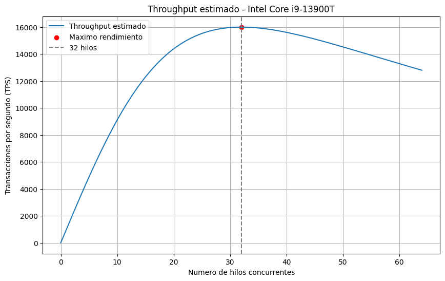

# Rendimiento Máximo de Throughput en Servidores Web

## Proyecto Final - Cálculo Diferencial

**Universidad de La Salle**  
**Programa:** Ingeniería de Software

---

## 1. Descripción del proyecto

Este proyecto tiene como objetivo analizar matemáticamente el rendimiento de un servidor web mediante el concepto de *Throughput*, entendido como la cantidad de transacciones que un servidor puede procesar por segundo.

Se busca determinar la cantidad óptima de hilos concurrentes que permite alcanzar el máximo rendimiento, utilizando herramientas del cálculo diferencial como la primera y segunda derivada.

Para contextualizar el análisis, se seleccionó como referencia el procesador **Intel Core i9-13900T**, integrado en equipos como el **Lenovo ThinkCentre M90q Gen 4**.

---

## 2. Hardware de referencia

El procesador seleccionado cuenta con las siguientes características:

| Característica | Especificación |
|---|---|
| Procesador | Intel Core i9-13900T |
| Núcleos | 24 |
| Hilos | 32 |
| TDP | 35 W |
| CPU Mark | 42.839 |

**Fuente:** [PassMark - CPU Benchmark](https://www.cpubenchmark.net/power_performance.html)

**Computador de referencia:** Lenovo ThinkCentre M90q Gen 4.

La información del procesador se utiliza como referencia para establecer el contexto del proyecto. Los resultados de throughput obtenidos corresponden a una simulación matemática y no a mediciones experimentales realizadas directamente sobre este equipo.

---

## 3. Modelo matemático

Para representar el comportamiento del rendimiento del servidor se utiliza la siguiente función:

\[
T(x)=\frac{1000x}{1+(x/32)^2}
\]

Donde:

- \(T(x)\): throughput estimado en transacciones por segundo (TPS).
- \(x\): cantidad de hilos concurrentes.
- \(32\): cantidad de hilos del procesador de referencia.
- \(1000\): constante de escala hipotética del modelo.

### Análisis mediante cálculo diferencial

Se utiliza la primera derivada para encontrar los puntos críticos de la función:

\[
T'(x)=\frac{1000(1-x^2/1024)}
{(1+x^2/1024)^2}
\]

Al igualar la primera derivada a cero se obtiene:

\[
x=32
\]

Posteriormente, mediante la segunda derivada:

\[
T''(32)=-15.625
\]

Al ser negativa, se confirma que el punto crítico corresponde a un máximo local.

### Resultados principales

| Indicador | Resultado |
|---|---:|
| Hilos óptimos | 32 |
| Throughput máximo estimado | 16.000 TPS |
| Primera derivada | 0 |
| Segunda derivada | -15.625 |

---

## 4. Implementación en Python

El programa desarrollado en Python permite:

- Definir el modelo matemático del throughput.
- Calcular la primera y segunda derivada.
- Identificar el punto de máximo rendimiento.
- Generar una tabla con diferentes cantidades de hilos.
- Construir y guardar una gráfica del comportamiento del modelo.

### Archivos principales

- `simulacion.py`: código fuente de la simulación.
- `Grafica2.png`: representación gráfica del throughput estimado.

---

## 5. Visualización de resultados

La siguiente gráfica representa el comportamiento del modelo matemático y permite observar cómo el rendimiento aumenta hasta alcanzar su máximo con 32 hilos concurrentes.



---

## 6. Tecnologías utilizadas

- **Python:** implementación del modelo matemático y cálculos.
- **NumPy:** operaciones numéricas.
- **Matplotlib:** generación de gráficas.
- **HTML:** estructura de la página web.
- **CSS:** diseño y presentación visual.
- **GitHub:** almacenamiento del código y publicación del proyecto mediante GitHub Pages.

---

## 7. Estructura del repositorio

```text
throughput-servidor-web/
│
├── index.html
├── estilos.css
├── simulacion.py
├── Grafica2.png
└── README.md
```

---

## 8. Conclusiones

Mediante la aplicación del cálculo diferencial se determinó que el modelo matemático alcanza su máximo rendimiento con 32 hilos concurrentes, obteniendo un throughput estimado de 16.000 transacciones por segundo.

La primera derivada permitió identificar el punto crítico, mientras que la segunda derivada confirmó que corresponde a un máximo local.

Finalmente, se relacionó el modelo con las características del procesador Intel Core i9-13900T y un equipo Lenovo ThinkCentre M90q Gen 4, utilizando sus especificaciones como referencia para contextualizar el análisis.

**Nota:** Los valores de throughput son resultados de una simulación matemática y no representan mediciones reales del procesador.

---

## 9. Referencias

- [PassMark Software - CPU Benchmarks](https://www.cpubenchmark.net/power_performance.html)
- [Intel - Intel Core i9-13900T](https://www.intel.com/content/www/us/en/products/sku/230495/intel-core-i913900t-processor-36m-cache-up-to-5-30-ghz/specifications.html)
- [Lenovo - ThinkCentre M90q Gen 4](https://www.lenovo.com/)
- Stewart, J. *Cálculo de una variable: Trascendentes tempranas*.
